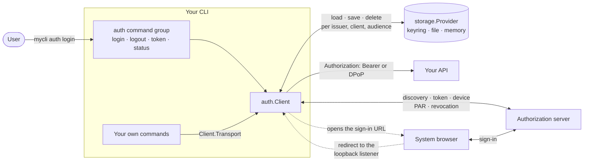
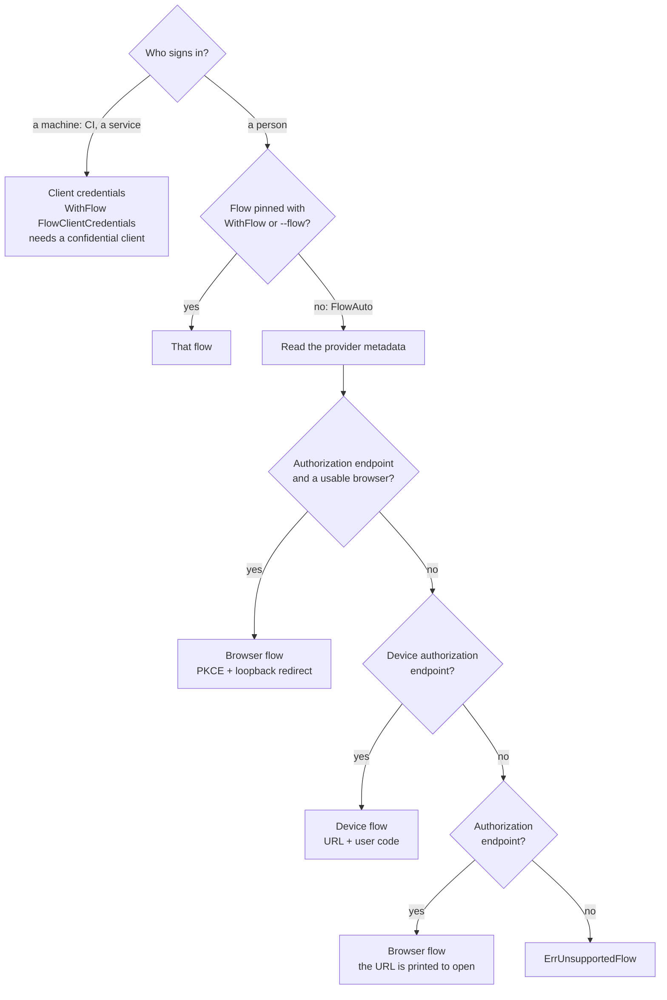

[](https://github.com/nauthera/cobra-oauth2/actions/workflows/ci.yml)
[](https://pkg.go.dev/github.com/nauthera/cobra-oauth2)

# cobra-oauth2

OAuth 2.0 and OpenID Connect sign-in for [Cobra](https://github.com/spf13/cobra)
command-line tools. Add one command group and your CLI gets `login`, `logout`,
`token` and `status`: a browser sign-in with PKCE when there is a browser, the
device flow over SSH and in containers, tokens in the operating system's
keyring, refresh on demand, and revocation on logout. Under the commands is a
`Client` you can use directly, for example as an `http.RoundTripper` that adds
the access token to your API calls. The library speaks the RFCs rather than one
provider's dialect: it is developed alongside
[nauthera-server](https://github.com/nauthera/nauthera-server) and tested
against the quirks of GitHub, Google, Entra ID, Okta, Auth0, Keycloak and others.


> **Stable since v1.0.0.** The module follows [semantic versioning](https://semver.org):
> minor and patch releases never break code that builds against an earlier v1.

---

## Contents

- [Features](#features)
- [How it fits together](#how-it-fits-together)
- [Install](#install)
- [Quickstart](#quickstart)
- [Choosing a flow](#choosing-a-flow)
- [Options](#options)
- [Storing tokens](#storing-tokens)
- [Calling your API](#calling-your-api)
- [Errors](#errors)
- [Testing a CLI built on it](#testing-a-cli-built-on-it)
- [Standards](#standards)
- [Providers](#providers)
- [Further reading](#further-reading)

## Features

- **Commands you can use as they are:** `login`, `logout`, `token` and `status`, alone or
  grouped under `auth`. They return errors (no `os.Exit`). Prompts go to
  stderr, so `TOKEN=$(mycli token)` captures only the token.
- **The login flow that fits the session:** the authorization code flow with PKCE and a loopback
  redirect when a browser can be opened, the device flow otherwise, and the
  client credentials grant for CI jobs.
- **Provider-agnostic:** OpenID Connect Discovery and RFC 8414 metadata
  with an exact issuer check, or static endpoints. Presets cover eleven common
  providers.
- **Tokens stored safely:** the system keyring by default (split across entries
  where the keyring limits their size), an opt-in `0600` file store, an
  in-memory store, a fallback chain, or your own `storage.Provider`. Tokens are
  stored per issuer, client and audience, so environments and tenants never mix.
- **Refresh handled for you:** expired tokens are refreshed before use. A
  rotated refresh token is saved before the new access token is handed out.
- **Sender-constrained tokens:** opt-in DPoP (RFC 9449) with nonce and
  clock-skew handling, on the token endpoint and on your API calls.
- **The extensions providers expect:** PAR, resource indicators, private_key_jwt,
  token exchange, introspection, RP-initiated logout.
- **Secure by default:** https everywhere except loopback, no redirects
  on back-channel requests, size-limited responses, ID tokens verified against
  the JWKS with an asymmetric-only algorithm allowlist, server text stripped of
  terminal escape sequences, and secrets redacted from every `String()` and log
  value. See [docs/security.md](docs/security.md).
- **Easy to test:** inject the HTTP client, clock, browser opener, output
  writers, device prompt and storage.

## How it fits together



The commands and your own code each build an `auth.Client` from the same
options, so they read and write the same stored token set. The client
discovers the server's endpoints, runs the login flow, keeps the token set in
a `storage.Provider`, refreshes it when it expires, and adds it to your API
requests. In the browser flow the sign-in happens in the system browser,
which redirects back to a short-lived listener on `127.0.0.1`; the device
flow and client credentials need no redirect.

## Install

```sh
go get github.com/nauthera/cobra-oauth2
```

The module needs Go 1.26 or later.

## Quickstart

Register a **public** client with your provider. Enable the authorization code
grant with the loopback redirect URI `http://127.0.0.1/callback` (any port), and
the device authorization grant. Then add the command group to your root command:

```go
package main

import (
	"context"
	"os"

	"github.com/spf13/cobra"

	"github.com/nauthera/cobra-oauth2/pkg/auth"
)

func main() {
	root := &cobra.Command{Use: "mycli", SilenceUsage: true}

	root.AddCommand(auth.NewAuthCommand(
		auth.WithIssuer("https://auth.example.com"),
		auth.WithClientID("mycli"),
	))

	if err := root.ExecuteContext(context.Background()); err != nil {
		os.Exit(1)
	}
}
```

```console
$ mycli auth login
Opened your browser to sign in. If it did not open, visit:

    https://auth.example.com/authorize?client_id=mycli&...

Waiting for the browser to finish signing in...
Logged in to https://auth.example.com as ada@example.com.
The access token expires in 10m.

$ mycli auth status
Logged in to https://auth.example.com
  Account:       ada@example.com (subject 3f1c...)
  Client ID:     mycli
  Token type:    Bearer
  Scopes:        openid offline_access
  Access token:  valid for 9m (until Tue, 24 Nov 2026 21:14:03 CET)
  Refresh token: yes

$ curl -H "Authorization: Bearer $(mycli auth token)" https://api.example.com/me
$ mycli auth logout
Logged out.
```

Nothing touches the network until a command runs, so `mycli --help` works
offline. To put the commands at the top level instead (`mycli login`), add
`auth.NewLoginCommand(opts...)`, `NewLogoutCommand`, `NewTokenCommand` and
`NewStatusCommand` individually, with the same options.

| Command | Flags | What it does |
| --- | --- | --- |
| `login` | `--flow auto\|browser\|device\|client-credentials`, `--no-browser`, `--scopes a,b`, `--qr` | Signs in and stores the tokens. |
| `token` | `--json` | Prints a valid access token to stdout, refreshing it first if needed. `--json` adds its type, expiry, scope and issuer. Refresh and ID tokens are never printed. |
| `status` | `--json` | Shows the account, scopes and expiry without printing any token. Exits non-zero when not logged in. |
| `logout` | `--no-browser` | Revokes the tokens at the server when it supports revocation, then deletes them locally. |

More complete programs are in [examples/](examples):

- [basic](examples/basic/cmd/root.go): any OpenID Connect issuer, with DPoP
  when available, and a `userinfo` command that uses `Client.Transport`.
- [nauthera](examples/nauthera/cmd/root.go): a CLI for an API behind
  nauthera-server: DPoP, PAR, resource indicators, keyring with a file
  fallback, logout with revocation and end-session, and token exchange.
- [client_credentials](examples/client_credentials/cmd/root.go): a CI job.
- [github](examples/github/cmd/root.go): the GitHub preset with the device flow.
- [auth0](examples/auth0): the Auth0 preset with an API audience, for people
  (browser or device flow) and Machine to Machine applications.

## Choosing a flow

| Flow | Option | Use it when | Needs |
| --- | --- | --- | --- |
| Auto (default) | `WithFlow(auth.FlowAuto)` | You want the right flow for the session. It picks the browser flow when a browser can be opened and the provider has an authorization endpoint, and the device flow otherwise (SSH, no display, containers). | Either of the two below |
| Browser | `WithFlow(auth.FlowBrowser)` | The user sits at the machine. This flow is the most secure and the fastest. | A loopback redirect URI registered for the client |
| Device | `WithFlow(auth.FlowDevice)` | There is no browser on this machine, or the provider has no usable redirect for CLIs. The user opens a URL on any device and enters a code. | The device grant enabled for the client, and a `device_authorization_endpoint` |
| Client credentials | `WithFlow(auth.FlowClientCredentials)` | A machine acts as itself: CI jobs and services. No user is involved. | A confidential client: `WithClientSecret`, `WithPrivateKeyJWT` or `WithClientAuthenticator` |

With the default `FlowAuto`, the flow is chosen at login from the provider's
metadata and the session:



Users can override the configured flow with `login --flow ...` and suppress
the browser with `--no-browser`. The browser flow always prints the URL as
well, so it works when the browser fails to open. The device flow prints the
verification URL and the user code, plus a QR code with `--qr`, to stderr.

The **browser flow** binds a listener to `127.0.0.1` on an ephemeral port and
sends `http://127.0.0.1:<port>/callback` as the redirect URI. Providers that
follow RFC 8252 § 7.3 accept any port for a registered loopback URI. For
providers that match the port exactly, use `WithRedirectPort`. For providers
that accept only `localhost`, use `WithRedirectHost("localhost")`.

## Options

Every option is an `auth.Option`, passed to `auth.NewClient` or to the
command constructors. A preset (see [Providers](#providers)) is an option
too. Put it first, because options after it override what it sets.

**Server and endpoints**

| Option | Default | Purpose |
| --- | --- | --- |
| `WithIssuer(url)` | | The issuer. Metadata is discovered from it on first use, and its `issuer` must match exactly. |
| `WithDiscoveryURL(url)` | | An exact metadata URL, for servers that publish it in a non-standard place. |
| `WithoutDiscovery()` | discovery on | Use only the configured endpoints. |
| `WithEndpoints(auth.Endpoints{...})` | | Set several endpoints at once. These override discovered values. |
| `WithAuthorizationEndpoint`, `WithTokenEndpoint`, `WithDeviceAuthorizationEndpoint`, `WithRevocationEndpoint`, `WithPushedAuthorizationEndpoint`, `WithIntrospectionEndpoint`, `WithEndSessionEndpoint`, `WithJWKSURL` | | Set one endpoint. |

**Client and authentication**

| Option | Default | Purpose |
| --- | --- | --- |
| `WithClientID(id)` | required | The OAuth client ID. |
| `WithClientSecret(s)` | none | A client secret. Use it for client credentials in controlled environments, or where a provider insists on one (Google). Never embed a real secret in a CLI you distribute. |
| `WithAuthMethod(m)` | `ClientAuthAuto` | `ClientAuthNone`, `ClientAuthSecretBasic`, `ClientAuthSecretPost` or `ClientAuthSecretJWT`. Auto picks Basic when there is a secret, and `none` otherwise. |
| `WithPrivateKeyJWT(signer, kid)` | | private_key_jwt client authentication (RFC 7523). |
| `WithAssertionAudience(a)` | `AssertionAudienceIssuer` | The `aud` claim of client assertions. The alternative is `AssertionAudienceTokenEndpoint`. |
| `WithClientAuthenticator(a)` | | A custom client authentication method, such as mTLS or a hardware key. |

**What to request**

| Option | Default | Purpose |
| --- | --- | --- |
| `WithScopes(s...)` | `openid offline_access` (presets may differ); none for client credentials | The scopes to request. |
| `WithAudience(aud)` | | Sends the `audience` parameter (Auth0 and others) with the authorization, device authorization and client credentials requests. Tokens are stored per audience. |
| `WithResource(uri...)` | | RFC 8707 resource indicators. Tokens are stored per resource set. |
| `WithAuthParam(k, v)` | | An extra parameter for the authorization and device requests, such as `prompt` or `access_type`. |
| `WithTokenParam(k, v)` | | An extra parameter for every token request. |

**Flow and user interaction**

| Option | Default | Purpose |
| --- | --- | --- |
| `WithFlow(f)` | `FlowAuto` | The login flow; see [Choosing a flow](#choosing-a-flow). |
| `WithRedirectHost(h)` | `127.0.0.1` | The loopback redirect host: `127.0.0.1`, `[::1]` or `localhost`. |
| `WithRedirectPort(p)` | `0` (ephemeral) | A fixed redirect port, for providers that match it exactly. |
| `WithRedirectPath(p)` | `/callback` | The redirect path. |
| `WithLoginTimeout(d)` | 5 minutes | How long the browser flow waits for the redirect. |
| `WithBrowser(bool)` | auto | Force opening the browser on or off. By default it opens unless the session looks headless. |
| `WithBrowserOpener(fn)` | system browser | Replace how URLs are opened. |
| `WithQRCode(bool)` | off | Print a QR code of `verification_uri_complete` in the device flow. |
| `WithDeviceAuthorizationHandler(fn)` | terminal prompt | Your own device-flow UI. |

**Token handling**

| Option | Default | Purpose |
| --- | --- | --- |
| `WithDPoP()` / `WithDPoPAuto()` | off | Bind tokens to a key with DPoP: always, or only when the server advertises support. |
| `WithPAR(mode)` | `PARIfRequired` | Pushed authorization requests: `PARIfRequired`, `PARIfAvailable` or `PARAlways`. |
| `WithRevokeOnLogout(bool)` | `true` | Revoke the tokens at the server on logout. |
| `WithEndSession(auth.EndSessionOptions{...})` | off | Also end the provider's browser session on logout (RP-initiated logout). |
| `WithIDTokenValidation(bool)` | `true` | Verify ID tokens against the provider's JWKS. |
| `WithClockSkew(d)` | 60 s | The leeway for ID token times. |
| `WithExpirySkew(d)` | 30 s | Refresh this long before the access token expires. |

**Environment**

| Option | Default | Purpose |
| --- | --- | --- |
| `WithStorage(p)` | system keyring | Where tokens are stored; see [Storing tokens](#storing-tokens). |
| `WithLocker(l)` | the storage, if it is a `storage.Locker` | The cross-process lock held while a token set is refreshed. |
| `WithAppName(name)` | root command name | The keyring service name, also used in the User-Agent. |
| `WithHTTPClient(hc)` | 30 s timeout, TLS 1.2+ | Proxies, custom CAs, mTLS. Redirects are never followed on back-channel POSTs, whatever the client says. |
| `WithInsecureHTTP()` | off | Allow plain-http endpoints on any host. For local test servers only. Loopback http is always allowed. |
| `WithOutput(out, errOut)` | the command's writers | Where messages go. Library methods write nothing unless this is set. |
| `WithLogger(*slog.Logger)` | none | Debug events (discovery, polling, refresh). Secrets are never logged. |
| `WithClock(c)` | system clock | The time source, for tests. |
| `WithEndpointMiddleware(mw...)` | | Wrap every back-channel request: token, device, revocation, PAR and introspection. |
| `WithUserAgent(ua)` | `<app> cobra-oauth2` | The User-Agent header. |

The full reference with every type is on
[pkg.go.dev](https://pkg.go.dev/github.com/nauthera/cobra-oauth2/pkg/auth).

## Storing tokens

By default tokens go to the operating system's credential store: macOS
Keychain, Windows Credential Manager, or the Secret Service on Linux. The
keyring service name is the **root command's name** (or `WithAppName`).
Renaming your binary therefore loses stored logins unless you pin the name:

```go
auth.WithAppName("com.example.mycli")
```

Each token set is stored under a hash of its issuer, client ID and audience
(`storage.Key`). Two environments or tenants that share a client ID never see
each other's tokens. The record is versioned JSON, and the keyring provider
splits it across several entries when it exceeds a platform limit, such as
Windows' 2.5 KB per credential.

| Provider | Constructor | Use for |
| --- | --- | --- |
| Keyring | `storage.NewKeyring(service)` | The default. Encrypted at rest by the OS and scoped to the user. |
| File | `storage.NewFile(dir)`, `storage.DefaultFileDir(app)` | Machines without a keyring. Writes one `0600` file per token set, atomically, in a `0700` directory. It refuses files other users can read. |
| Memory | `storage.NewMemory()` | Tests and one-shot CI jobs. The tokens are gone when the process exits. |
| Fallback | `storage.Fallback(primary, secondary)` | Use the keyring, and fall back to a file when the keyring is unavailable (SSH, containers). |

A keyring with a file fallback:

```go
dir, err := storage.DefaultFileDir("mycli") // e.g. ~/.config/mycli/tokens
if err != nil {
	return err
}
opts := []auth.Option{
	auth.WithIssuer("https://auth.example.com"),
	auth.WithClientID("mycli"),
	auth.WithStorage(storage.Fallback(storage.NewKeyring("mycli"), storage.NewFile(dir))),
}
```

Any type with `Get`, `Set` and `Delete` is a `storage.Provider`. `Get`
returns an error wrapping `storage.ErrNotFound` when nothing is stored, and
`Delete` of a missing key returns nil. A provider must be safe for concurrent
use. `storage.Token` holds secrets: its `String`, `GoString` and `LogValue`
redact them, but your provider must protect them at rest.

Servers that rotate refresh tokens revoke the whole grant when a spent one is
presented again, which is what two runs of a CLI refreshing at the same
moment would do. The client therefore holds a lock while it reads, refreshes
and stores a token set, and reads storage again once it has the lock, so a
token another run just refreshed is reused. The keyring and file providers
implement `storage.Locker` with a lock file per token set (the keyring's
live under the user's cache directory). A custom provider backed by shared
storage should implement it too, for example with `storage.NewFileLocker`,
or pass a locker with `auth.WithLocker`. A valid token set is kept in memory
for the life of the `Client`, so API calls do not read the keyring each time.

## Calling your API

Build a `Client` with the same options as the commands and use its transport.
`auth.NewClientForCommand` applies the same defaults the commands use (the
root command's name as the keyring service, unless you pinned one with
`WithAppName`, and the command's writers), so it reads the token the `login`
command stored. The transport adds `Authorization: Bearer <token>`, refreshes
an expired token, and retries once with a fresh token when the server answers
`401 invalid_token`. With DPoP it sends `Authorization: DPoP <token>` and a
new proof on every request, and answers the server's nonce challenges:

```go
func newAPIClient(cmd *cobra.Command, opts []auth.Option) (*http.Client, error) {
	client, err := auth.NewClientForCommand(cmd, opts...)
	if err != nil {
		return nil, err
	}
	return &http.Client{
		Transport: client.Transport(nil, auth.WithAllowedOrigins("https://api.example.com")),
	}, nil
}
```

The transport sends the token only to the origins it is bound to: those
given with `WithAllowedOrigins`, else those of the `WithResource` URLs, else
the origin of the first request. A request to another origin fails with
`auth.ErrOriginNotAllowed`. A redirect to another origin, such as a signed
download URL, is followed without the token, and plain http is refused except
for loopback hosts. If your API should never redirect, also set
`CheckRedirect` on the `http.Client`.

If you only need the string, `client.AccessToken(ctx)` returns a valid access
token. `client.Token(ctx)` returns the whole `*storage.Token`. A DPoP-bound
token is useless without a proof, so prefer the transport over copying the
string into your own headers. The `token` command warns on stderr when it
prints a DPoP-bound token.

The client also offers `Login`, `Refresh`, `Logout`, `Revoke`, `Status`,
`Metadata`, `VerifyIDToken`, `ExchangeToken` (RFC 8693), `Introspect`
(RFC 7662, confidential clients) and `EndSessionURL`. The lower-level
`StartDeviceAuthorization` and `PollDeviceAuthorization` let you build your
own device-flow UI.

## Errors

Errors wrap sentinels, so you can branch with `errors.Is` and `errors.As`:

```go
_, err := client.Token(ctx)
var oe *auth.OAuthError
switch {
case err == nil:
case errors.Is(err, auth.ErrNotLoggedIn), errors.Is(err, auth.ErrLoginRequired):
	return fmt.Errorf("run `mycli auth login` first: %w", err)
case errors.As(err, &oe) && oe.Retryable():
	return fmt.Errorf("the sign-in service is busy, try again shortly: %w", err)
default:
	return err
}
```

An `*auth.OAuthError` carries the server's `error` code, description and
URI, already stripped of control characters. It matches the sentinel for its
code (`auth.ErrInvalidGrant`, `auth.ErrSlowDown`, `auth.ErrInvalidTarget` and
so on). An unexpected status without an OAuth body becomes an
`*auth.StatusError`, which never includes the response body.

## Testing a CLI built on it

Everything that touches the outside world can be replaced:

```go
var prompt bytes.Buffer
opts := []auth.Option{
	auth.WithIssuer(srv.URL), // an httptest server; loopback http is allowed
	auth.WithClientID("test"),
	auth.WithHTTPClient(srv.Client()),
	auth.WithStorage(storage.NewMemory()),
	auth.WithBrowser(false),
	auth.WithOutput(io.Discard, &prompt),
	auth.WithDeviceAuthorizationHandler(func(ctx context.Context, da *auth.DeviceAuthorization) error {
		// approve da.UserCode at the fake server here
		return nil
	}),
}
```

Use `WithClock` for expiry and polling, `WithBrowserOpener` to drive the
browser flow, and cobra's `cmd.SetOut`/`cmd.SetErr` to capture command output.

## Standards

| Specification | Support |
| --- | --- |
| RFC 6749 OAuth 2.0 (authorization code, client credentials, refresh) | Supported |
| RFC 6750 Bearer tokens | Supported |
| RFC 7636 PKCE (S256 only, always sent) | Supported |
| RFC 8252 Native apps (loopback redirect, system browser) | Supported |
| RFC 8414 / OpenID Connect Discovery 1.0 | Supported |
| RFC 8628 Device authorization grant | Supported |
| RFC 7009 Token revocation | Supported |
| RFC 9207 Authorization server issuer identification | Supported |
| OpenID Connect Core 1.0 ID token validation | Supported |
| RFC 9449 DPoP | Supported (opt-in) |
| RFC 9126 Pushed authorization requests | Supported |
| RFC 7523 JWT client authentication | Supported |
| RFC 8707 Resource indicators | Supported |
| RFC 8693 Token exchange | Supported |
| RFC 7662 Token introspection | Supported (confidential clients) |
| OpenID Connect RP-Initiated Logout 1.0 | Supported (opt-in) |
| RFC 9700 OAuth 2.0 Security BCP | Largely followed |
| RFC 8705 mTLS | Through a custom HTTP client and authenticator |
| Implicit and password grants | Not supported, by design |

Section-level detail, with what is not covered, is in
[docs/rfc-support.md](docs/rfc-support.md).

## Providers

| Provider | Preset | Browser flow | Device flow | Revocation | Notes |
| --- | --- | --- | --- | --- | --- |
| [nauthera-server](docs/nauthera.md) | `auth.Nauthera(issuer)` | yes | yes | yes | Reference server: DPoP, PAR, resource indicators, private_key_jwt. |
| GitHub | `auth.GitHub()`, `auth.GitHubEnterprise(host)` | yes | yes (enable it per app) | no | No discovery or ID tokens. |
| Google | `auth.Google()` | yes | yes (TV and limited-input clients) | yes | Requires the client's non-confidential secret. |
| Microsoft Entra ID | `auth.EntraID(tenant)` | yes | yes (allow public client flows) | no | Multi-tenant issuers are handled. |
| Okta | `auth.Okta(issuer)` | yes | yes (enable the grant) | yes | DPoP with server nonces. |
| Auth0 | `auth.Auth0(domain, audience)` | yes | yes (enable the grant) | refresh tokens | Pass an audience to get an API token. |
| Keycloak | `auth.Keycloak(baseURL, realm)` | yes | yes (enable the grant) | yes | |
| GitLab | `auth.GitLab(baseURL)` | yes | 17.1 and later | yes | |
| ZITADEL | `auth.Zitadel(issuer)` | yes | yes | yes | |
| Amazon Cognito | `auth.Cognito(region, pool, domain)` | yes (fixed port) | no | yes | Callback URL matched exactly, port included. |
| Dex | `auth.Dex(issuer)` | yes | yes | no | Logout is local only. |
| Any other OIDC or OAuth 2.0 server | `auth.WithIssuer(...)` or explicit endpoints | | | | |

```go
auth.NewAuthCommand(
	auth.EntraID("organizations"),
	auth.WithClientID("00000000-0000-0000-0000-000000000000"),
	auth.WithScopes("openid", "offline_access", "api://my-api/.default"),
)
```

Per-provider setup and the quirks the library handles are described in
[docs/providers.md](docs/providers.md).

## Further reading

- [docs/nauthera.md](docs/nauthera.md): using the library with nauthera-server,
  and running the end-to-end tests.
- [docs/providers.md](docs/providers.md): provider notes.
- [docs/rfc-support.md](docs/rfc-support.md): the standards matrix.
- [docs/security.md](docs/security.md): the threat model and advice for integrators.
- [CONTRIBUTING.md](CONTRIBUTING.md): development setup, Conventional Commits
  and releases.
- [SECURITY.md](SECURITY.md): reporting a vulnerability.

## License

MIT. See [LICENSE](LICENSE).
