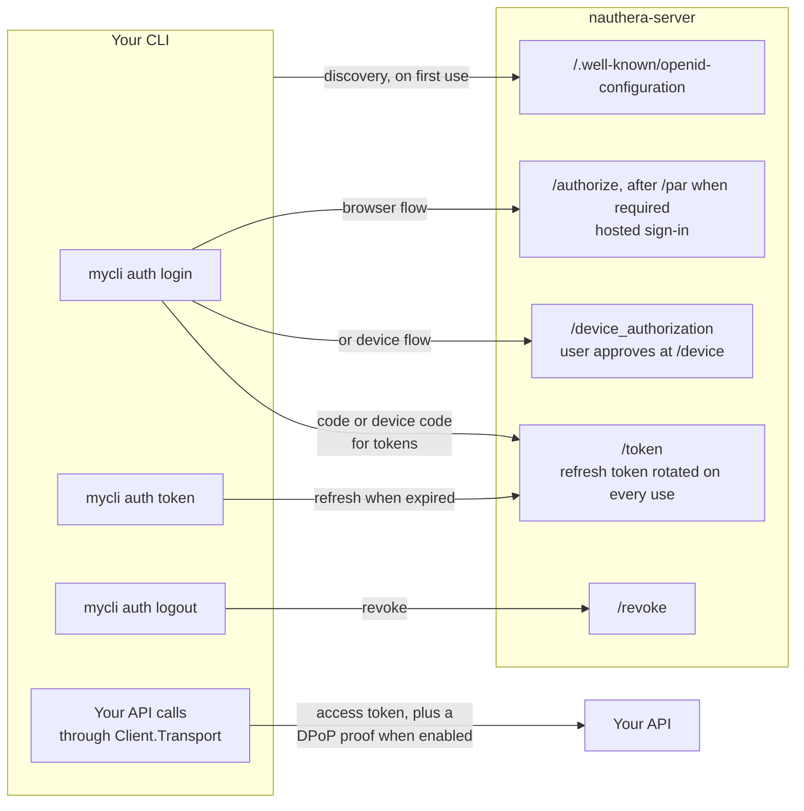
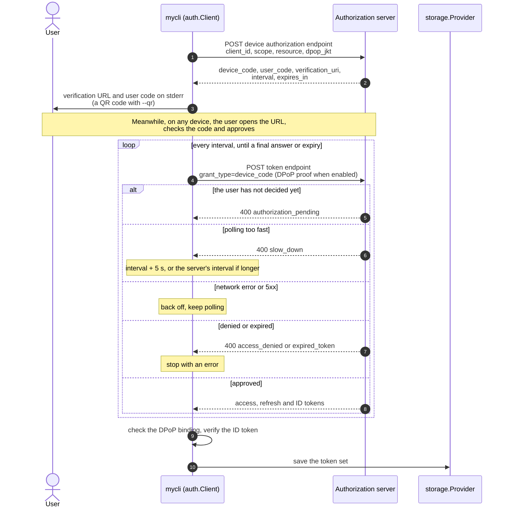
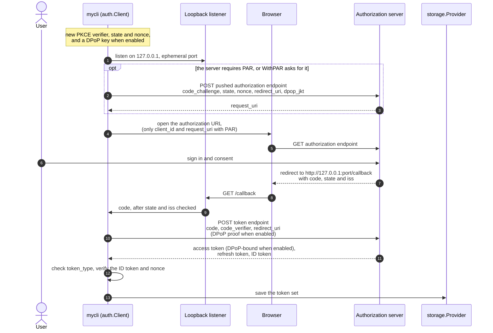

# cobra-oauth2 with nauthera-server

[nauthera-server](https://github.com/nauthera/nauthera-server) is the
authorization server this library is developed alongside. It serves as the
reference for the live tests, and its responses are the shapes the unit tests
replay. The library is still a **standards client**, not a nauthera client:
it reads the server's discovery document and follows the RFCs, and contains
no nauthera-specific code paths. The `auth.Nauthera` preset only sets the
issuer and default scopes.

This guide explains how the two fit together: what to register, what the
server advertises, and how the library reacts. It deliberately does not copy
the server's administration steps. Flags, config keys and screens change
between server releases, so for exact procedures follow the server's own
documentation:

- its [README](https://github.com/nauthera/nauthera-server#readme) for
  running it locally and its feature set,
- [docs/CONFIGURATION.md](https://github.com/nauthera/nauthera-server/blob/main/docs/CONFIGURATION.md)
  for the issuer, FAPI switches, signing keys and the other settings mentioned
  below,
- its [CONTRIBUTING.md](https://github.com/nauthera/nauthera-server/blob/main/CONTRIBUTING.md)
  for a development setup.

---

## 1. The picture



Everything the library needs comes from the discovery document. When the
server turns a feature on or off (PAR enforcement, DPoP algorithms, signing
algorithms), the CLI follows on its next run without a code change.

## 2. Register the client

What to register depends on who the CLI acts for.

**A CLI that people sign in to** is a *public* client: it runs on users'
machines and cannot keep a secret. Register it with:

| Setting | Value | Why |
| --- | --- | --- |
| Client authentication | `none` (public) | A secret compiled into a distributed binary is not secret. PKCE protects the code instead, and nauthera always requires PKCE for public clients. |
| Grant types | `authorization_code`, `refresh_token`, and the device code grant `urn:ietf:params:oauth:grant-type:device_code` | The library uses the browser flow when it can and the device flow otherwise. Leave out the one you do not want, and pin the flow with `WithFlow`. |
| Redirect URIs | `http://127.0.0.1/callback`, optionally also `http://[::1]/callback` | The loopback redirect of RFC 8252. See below. A device-only client needs none. |
| Scopes | `openid` and `offline_access`, plus what your API needs | Without `offline_access` nauthera issues no refresh token, and users must log in again when the access token expires. |
| Refresh tokens | allowed | nauthera issues a refresh token only when the client allows refresh **and** the grant includes `offline_access`. |

**A job that acts as itself** (CI, a cron job, a service) is a
*confidential* client with the `client_credentials` grant. It authenticates
with a secret (`client_secret_basic` is the default the library picks) or,
better, with a key (`private_key_jwt`, when the server is configured to
resolve client keys). It needs no redirect URI and no `offline_access`.

Register the client with whatever the server offers for administration. At
the time of writing that is the `nauthera-cli create client` command and the
admin UI; `nauthera-cli create client --help` lists the current flags.
For a tenant organization, register the client in that organization. The
CLI's issuer is then the organization's issuer.

### Loopback redirect URIs

The library listens on `127.0.0.1` on a free port and sends
`http://127.0.0.1:<port>/callback`. nauthera implements RFC 8252 § 7.3
port matching: a registered loopback URI matches a request that differs
**only in the port**. Scheme, host and path must be identical. Therefore:

- Register `http://127.0.0.1/callback` once. Any port then works.
- `localhost` and `127.0.0.1` are different hosts to the server. If you
  register `localhost`, also configure `auth.WithRedirectHost("localhost")`.
- If you change the path with `WithRedirectPath`, register that path.

## 3. Configure the CLI

```go
root.AddCommand(auth.NewAuthCommand(
	auth.Nauthera("https://auth.example.com"), // or https://auth.example.com/orgs/acme
	auth.WithClientID("mycli"),
	auth.WithDPoPAuto(),                       // optional, see below
))
```

`auth.Nauthera(issuer)` is the same as `auth.WithIssuer(issuer)` with the
scopes `openid offline_access`. Add `WithScopes(...)` to request more, and
include `offline_access` again, because `WithScopes` replaces the defaults.
Add `WithResource("https://api.example.com")` when your API is registered
as a resource. The issuer must be exactly what the server's discovery
document says, with no trailing slash for a bare origin.

[examples/nauthera](../examples/nauthera/cmd/root.go) is a complete CLI built
this way. Besides the `auth` commands, it has a `get` command that calls your
API through `Client.Transport` and an `exchange` command for RFC 8693. It
turns on DPoP when advertised and PAR when available. Tokens go to the
keyring, with a file fallback on headless hosts. Logout revokes the tokens and
prints the end-session URL. Point it at a server with `NAUTHERA_ISSUER`,
`NAUTHERA_CLIENT_ID` and, optionally, `NAUTHERA_API`:

```sh
export NAUTHERA_ISSUER=https://auth.example.com NAUTHERA_CLIENT_ID=mycli
go run ./examples/nauthera auth login
go run ./examples/nauthera get https://api.example.com/v1/me
```

## 4. What nauthera advertises, and how the library reacts

| nauthera behaviour | What the library does |
| --- | --- |
| Publishes metadata at both the OpenID Connect location and the RFC 8414 location, for the main issuer and for tenant issuers (`/orgs/<slug>`). | Tries `{issuer}/.well-known/openid-configuration` first, then the RFC 8414 location. Refuses a document whose `issuer` differs by even one byte. |
| `code_challenge_methods_supported: ["S256"]`. It refuses an authorization request without `code_challenge_method`. | Always sends PKCE with `code_challenge_method=S256`, for confidential clients too. Never sends `plain`. |
| `authorization_response_iss_parameter_supported: true` (RFC 9207). | Requires `iss` on the redirect and checks that it equals the issuer, as a mix-up defence. |
| `require_pushed_authorization_requests` is false by default and true for FAPI deployments or FAPI organizations. | Pushes the authorization request to `/par` whenever the flag is set, with no configuration needed. `WithPAR(auth.PARIfAvailable)` or `PARAlways` pushes even when it is not required. The browser URL then carries only `client_id` and `request_uri`. |
| `dpop_signing_alg_values_supported` (ES256 and RSA algorithms). The `/token` endpoint always asks for a nonce. | With `WithDPoPAuto()` or `WithDPoP()`, generates a P-256 key per login (ES256), sends `dpop_jkt` at `/authorize`, `/par` and `/device_authorization`, and answers the first `use_dpop_nonce` with one retry. It caches the nonce from every response. |
| DPoP proofs must be at most 60 s old and at most 5 s in the future. | Corrects the proof's `iat` from the server's `Date` header when the local clock is off, and retries once on a time-related `invalid_dpop_proof`. |
| ID tokens are signed with ES256 by default (RS256 only if configured). They carry no `azp`. | Verifies against the JWKS with whatever asymmetric algorithm the metadata lists. It does not assume RS256. |
| `token_endpoint_auth_methods_supported` includes `client_secret_basic`, `client_secret_post`, `none`, and `private_key_jwt` when client keys are configured. | A public client sends only `client_id`. A secret goes in HTTP Basic, form-encoded first as RFC 6749 § 2.3.1 requires (nauthera decodes it that way). A key uses `private_key_jwt` with a fresh `jti` on every request. |
| Revocation at `/revoke` answers 200 for every outcome. `503 temporarily_unavailable` means the token is still live. | Logout revokes the refresh token (which ends the whole grant) and then the access token. It retries a 503 up to three times and deletes the local copy in any case. |
| Introspection is for confidential clients only. | `Client.Introspect` refuses without sending anything when the client has no credentials. |
| Token exchange is not offered. `/token` answers it with `503 temporarily_unavailable`. | `Client.ExchangeToken` returns `auth.ErrUnsupportedFlow`. |
| Device codes last 15 minutes with a 5 s interval. `slow_down` permanently adds 5 s on the server side. | Polls at the server's interval, adds 5 s on every `slow_down`, backs off on network errors, and stops at expiry, on `access_denied` and on `expired_token`. |

nauthera does not accept EdDSA DPoP proofs. The library prefers ES256
whenever a server advertises it, so this never comes up with the defaults.

### The device flow, step by step

The device flow (RFC 8628) needs nothing but the terminal on the CLI's side.
The user approves on any device; the CLI polls the token endpoint until the
server gives a final answer.



### The browser flow, step by step

The browser flow is the authorization code flow with PKCE and a loopback
redirect (RFC 8252). The push to the PAR endpoint happens only when the
server requires it or `WithPAR` asks for it, and the DPoP parts only with
`WithDPoP` or `WithDPoPAuto`.



The listener answers only the redirect path, accepts one response with the
expected `state`, and shuts down after it. The `iss` parameter must equal the
issuer, because nauthera advertises
`authorization_response_iss_parameter_supported`.

## 5. Refresh tokens and rotation

nauthera rotates the refresh token on **every** refresh, and treats reuse of
a spent refresh token as theft: it revokes the whole grant and answers only
`invalid_grant`. The library is built for this:

- A refreshed token set is saved to storage **before** the new access token
  is returned, so a crash cannot leave the spent refresh token as the stored
  one. It is saved even when a later check of the response fails (an ID
  token that does not validate, a JWKS that cannot be fetched): the rotated
  refresh token is never thrown away.
- A failed refresh is never retried with the same refresh token. `invalid_grant`
  on refresh becomes `auth.ErrLoginRequired`, and the user logs in again.
- Refreshes are serialized within one process, and **across processes** by a
  lock file per token set (flock on Unix, LockFileEx on Windows). The keyring
  keeps its lock files under the user's cache directory, the file provider
  next to the tokens. After taking the lock, the client reads storage again,
  so when a parallel run (a shell loop, an editor integration, `make -j`)
  has just refreshed, its token set is used and the spent refresh token is
  never presented. A custom storage provider gets the same protection by
  implementing `storage.Locker`, or with `auth.WithLocker`.
- A DPoP-bound refresh token stays bound to the key it was issued for. The
  key is stored with the tokens and signs every later refresh proof.

The lock covers processes on one machine. Two machines that share one token
store (a network home directory, say) are not coordinated; give each its own
login.

The default lifetimes are about 10 minutes for the access token and 30 days
for the refresh token. They are server settings, so check your deployment.

## 6. DPoP with nauthera

DPoP is off by default in the library. With nauthera it is worth turning on:
a stolen access or refresh token is useless without the private key, and the
key never leaves the user's keyring.

- `WithDPoPAuto()` uses DPoP when the server advertises it and Bearer tokens
  otherwise. This is the right choice for a CLI that talks to several servers.
- `WithDPoP()` requires it, and fails a login that comes back with a Bearer
  token (`auth.ErrDPoPNotBound`).

Your API must accept DPoP tokens, which means checking the proof as well as
the token. Call it through `Client.Transport`, which adds a proof bound to
the access token (`ath`) on every request and handles the resource server's
`use_dpop_nonce` challenge. `mycli auth token` still prints the token, with
a note on stderr that it is DPoP-bound and therefore not usable with
`curl -H "Authorization: Bearer ..."`.

## 7. Running the end-to-end tests

The unit suite (`just test`) needs no server. The live tests in `e2e/` run
the real flows against a running nauthera-server. They are behind the `e2e`
build tag, so neither `just test` nor CI runs them. They are useful when you
change a flow, or to check a new server release against the library.

The shape of a run:

1. **Get a server.** Run nauthera-server locally as its README and
   CONTRIBUTING.md describe. You can also point the tests at a test instance
   you already have. The issuer must be https. For a local server with a
   self-signed certificate, point `NAUTHERA_E2E_CA_FILE` at its CA bundle;
   never turn off verification. (`SSL_CERT_FILE` works on Linux only: on
   macOS Go uses the system verifier and ignores it.)
2. **Register a public client** for the tests as in [§ 2](#2-register-the-client).
   The device grant is the minimum. Add the authorization code grant with a
   loopback redirect URI to exercise the browser flow.
3. **Tell the tests where to find them:**

   ```bash
   export NAUTHERA_E2E_ISSUER=https://127.0.0.1:8443   # your server's issuer
   export NAUTHERA_E2E_CLIENT_ID=<client id>
   ```

   Further `NAUTHERA_E2E_*` variables are listed in the `e2e` package's doc
   comment and in [e2e/README.md](../e2e/README.md): a confidential client for
   client credentials, and `NAUTHERA_E2E_USER_EMAIL` and
   `NAUTHERA_E2E_USER_PASSWORD` for a test user (a password, a verified
   address, no second factor). A `.env` file is git-ignored if you want to
   keep them.
4. **Run** `just e2e`. Arguments pass through to `go test`:
   `just e2e -run TestDevice`.

What runs depends on what you configure:

- **Issuer and public client only:** discovery (exact issuer, https
  endpoints, S256, the device grant, RFC 9207 `iss`), the device flow up to
  `authorization_pending` with and without DPoP, and the token exchange gate.
- **A confidential client** adds client credentials, introspection,
  revocation and the refusal of a wrong secret.
- **A test user** adds the full device lifecycle without a browser. The tests
  sign in as the user through the server's hosted sign-in API and approve or
  deny the code from a `DeviceAuthorizationHandler`. They cover approval,
  denial (`access_denied`), DPoP binding when advertised, refresh rotation,
  reuse detection, and revocation on logout.
- **`NAUTHERA_E2E_INTERACTIVE=1`** runs the same login with a person
  approving the code in a browser, for a server where no password user is
  available.

The sign-in and device decision calls are a server detail and may change.
When a test breaks on them and not on the protocol, the fix belongs in the
e2e helper (`hostedUser`), not in the library.

Nothing in this module depends on nauthera-server's Go packages, and it
should stay that way. The tests speak HTTP only. Browser-flow logins are not
automated: they would need the server's consent and redirect handling
replayed outside a browser, and the unit suite already covers the client side
of them against recorded nauthera responses.

## 8. When the two disagree

The RFC decides. If nauthera changes protocol behaviour in a way that breaks
a client that follows the RFCs, raise it on the server first. If the library
needs something the server does not offer, open a server issue that names the
standard and section, and test the library against a fixture or another
provider meanwhile. [CONTRIBUTING.md § 7](../CONTRIBUTING.md#7-working-alongside-nauthera-server)
describes how changes usually flow between the two repositories.
