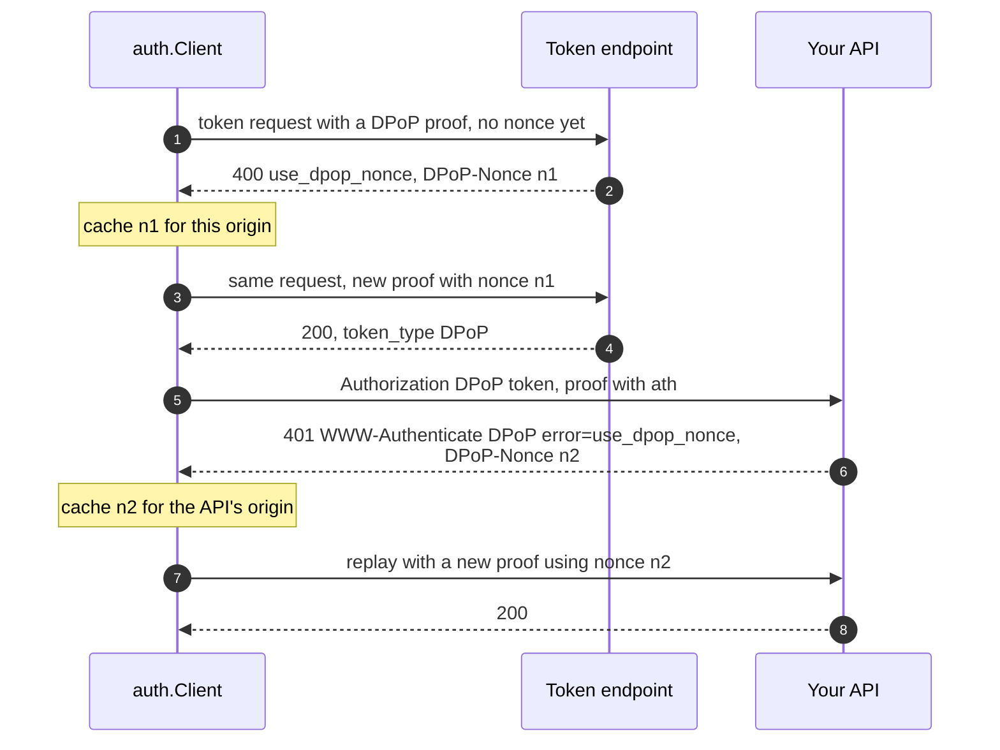

# Standards support

This page describes what cobra-oauth2 implements as an OAuth 2.0 / OpenID
Connect **client**, section by section, and what it leaves out on purpose.
"Supported" means the library does it by default, or with the named option,
and the unit tests cover it. Anything server-side, such as dynamic client
registration and the registration UI, is out of scope.

Status values:

- **yes**: implemented as the section describes.
- **opt-in**: implemented, enabled by the named option.
- **partial**: implemented with the limits given in the notes.
- **no**: not implemented.

## Summary

| Specification | Status |
| --- | --- |
| [RFC 6749](https://www.rfc-editor.org/rfc/rfc6749) OAuth 2.0 | yes (authorization code, client credentials, refresh; no implicit or password grant) |
| [RFC 6750](https://www.rfc-editor.org/rfc/rfc6750) Bearer token usage | yes (header only) |
| [RFC 7636](https://www.rfc-editor.org/rfc/rfc7636) PKCE | yes (S256 only, always) |
| [RFC 8252](https://www.rfc-editor.org/rfc/rfc8252) OAuth 2.0 for native apps | yes (loopback redirect, system browser) |
| [RFC 8414](https://www.rfc-editor.org/rfc/rfc8414) Authorization server metadata | yes |
| [OpenID Connect Discovery 1.0](https://openid.net/specs/openid-connect-discovery-1_0.html) | yes |
| [RFC 8628](https://www.rfc-editor.org/rfc/rfc8628) Device authorization grant | yes |
| [RFC 7009](https://www.rfc-editor.org/rfc/rfc7009) Token revocation | yes |
| [RFC 9207](https://www.rfc-editor.org/rfc/rfc9207) Issuer identification | yes |
| [OpenID Connect Core 1.0](https://openid.net/specs/openid-connect-core-1_0.html) | yes (ID token validation; no UserInfo helper) |
| [RFC 9449](https://www.rfc-editor.org/rfc/rfc9449) DPoP | opt-in |
| [RFC 9126](https://www.rfc-editor.org/rfc/rfc9126) Pushed authorization requests | yes (automatic when required, opt-in otherwise) |
| [RFC 7523](https://www.rfc-editor.org/rfc/rfc7523) JWT client authentication | opt-in |
| [RFC 8707](https://www.rfc-editor.org/rfc/rfc8707) Resource indicators | opt-in |
| [RFC 8693](https://www.rfc-editor.org/rfc/rfc8693) Token exchange | yes (`Client.ExchangeToken`) |
| [RFC 7662](https://www.rfc-editor.org/rfc/rfc7662) Token introspection | partial (confidential clients; no JWT responses) |
| [OpenID Connect RP-Initiated Logout 1.0](https://openid.net/specs/openid-connect-rpinitiated-1_0.html) | opt-in |
| [RFC 7638](https://www.rfc-editor.org/rfc/rfc7638) JWK thumbprint | yes (for `dpop_jkt`) |
| [RFC 9700](https://www.rfc-editor.org/rfc/rfc9700) OAuth 2.0 Security BCP | partial (see below) |
| [RFC 8705](https://www.rfc-editor.org/rfc/rfc8705) Mutual TLS | partial (bring your own client and authenticator) |
| [RFC 9101](https://www.rfc-editor.org/rfc/rfc9101) JAR, [RFC 7591](https://www.rfc-editor.org/rfc/rfc7591) dynamic registration, [RFC 9701](https://www.rfc-editor.org/rfc/rfc9701) JWT introspection responses | no |
| OpenID Connect front-channel, back-channel and session management | no (not meaningful for a CLI) |

## RFC 6749: OAuth 2.0

| Section | Status | Notes |
| --- | --- | --- |
| § 2.3.1 Client password | yes | `client_secret_basic` by default when a secret is set. Each part is form-encoded before Base64, and a space is encoded as `%20`. `client_secret_post` is used with `WithAuthMethod(ClientAuthSecretPost)`, when discovery advertises only that, or when the preset says so (GitHub, Google). Credentials are never sent in both header and body. |
| § 3.1, § 3.2 Endpoints over TLS | yes | Every endpoint must be https. Loopback http is allowed, and anything else needs `WithInsecureHTTP`. Discovered endpoints are checked too. |
| § 4.1 Authorization code grant | yes | `FlowBrowser`. `state` is 256 random bits, compared in constant time and accepted once. `redirect_uri` is repeated exactly at the token endpoint. Callback `error`, `error_description` and `error_uri` become an `*OAuthError`. |
| § 4.2 Implicit grant | no | Deprecated by RFC 9700. |
| § 4.3 Password grant | no | Deprecated by RFC 9700. |
| § 4.4 Client credentials grant | yes | `FlowClientCredentials`. No default scopes, and no empty `scope` parameter. |
| § 5.1 Successful response | yes | `access_token` is required. `token_type` defaults to Bearer when absent and is compared case-insensitively. A missing `expires_in` means no expiry. Numbers may be strings. Unknown members go to `Token.Extra`. |
| § 5.2 Error response | yes | A typed `*OAuthError` that matches a sentinel per code. Text from the server is stripped of control characters and truncated. An error body is recognized at any HTTP status. |
| § 6 Refreshing | yes | A rotated refresh token replaces the old one and is stored before use. If the response has no refresh token, the old one is kept. A failed refresh is never retried with the same token. |
| § 10.12 CSRF | yes | Via `state`, plus PKCE and `nonce`. |

## RFC 6750: Bearer token usage

| Section | Status | Notes |
| --- | --- | --- |
| § 2.1 Authorization header | yes | `Client.Transport` sends `Authorization: Bearer <token>`. |
| § 2.2, § 2.3 Form body and query | no | Deliberately never used. |
| § 3 `WWW-Authenticate` | yes | Parsed properly, not by substring. On `401 error="invalid_token"` the transport refreshes and replays the request once, when the request body can be replayed. Other challenges pass through to the caller. |
| § 5.2, § 5.3 Token disclosure | yes | The transport sends the token only to the origins it is bound to (`WithAllowedOrigins`, the `WithResource` URLs, or the first request's origin), follows cross-origin redirects without it, and never sends it over plain http to a remote host. |

## RFC 7636: PKCE

| Section | Status | Notes |
| --- | --- | --- |
| § 4.1 Verifier | yes | 32 random bytes, base64url (43 characters). |
| § 4.2 Challenge | yes | S256 only. `plain` is never offered. |
| § 4.3 Sending | yes | Sent on every authorization request, for confidential clients too, whether or not discovery lists `code_challenge_methods_supported`. |

## RFC 8252: OAuth 2.0 for native apps

| Section | Status | Notes |
| --- | --- | --- |
| § 7.3 Loopback redirect | yes | Binds `127.0.0.1` (or `[::1]`) only, never all interfaces. The port is ephemeral by default and fixed with `WithRedirectPort`. `localhost` is available as the redirect host for providers that demand it, but the listener still binds the loopback address. |
| § 7.1, § 7.2 Custom schemes and claimed URLs | no | Not applicable to a CLI. |
| § 8.1 PKCE | yes | See RFC 7636. |
| § 8.3 Loopback security | yes | The listener accepts one GET on the redirect path with the right `state`. Other paths get 404, and a wrong `state` gets an error page while the listener keeps waiting. It shuts down on success, error or timeout (`WithLoginTimeout`, 5 minutes by default). The response page is `no-store`, with a strict CSP and no referrer. |
| § 8.12 External user agent | yes | The system browser, never an embedded view. The URL is always printed as well. Only https URLs (or loopback http) are handed to the OS opener. |

## RFC 8414 and OpenID Connect Discovery 1.0

| Section | Status | Notes |
| --- | --- | --- |
| RFC 8414 § 3, OIDC Discovery § 4 Locations | yes | Tries `{issuer}/.well-known/openid-configuration`, then the RFC 8414 § 3.1 location with the well-known segment inserted before the issuer's path. `WithDiscoveryURL` names an exact location. `MetadataURLs` exposes the candidate list. |
| RFC 8414 § 3.3, OIDC Discovery § 4.3 Issuer check | yes | The document's `issuer` must equal the configured one byte for byte. There are two narrow preset exceptions: the Entra ID `{tenantid}` template and Google's second issuer spelling. A refused document stops the search, because it is not a sign that the real one is elsewhere. |
| Content type | yes | A JSON content type is required when one is sent. |
| Capabilities | yes | Optional endpoints are treated as capabilities, and static endpoints override or fill gaps. `grant_types_supported` gates token exchange and the flows, when the server publishes it. |
| Redirects | yes | Discovery and JWKS GETs follow at most three same-origin redirects. |
| Caching | partial | The metadata is fetched once per `Client` (once per command run) and not otherwise cached. `Cache-Control` is not used. |

## RFC 8628: Device authorization grant

| Section | Status | Notes |
| --- | --- | --- |
| § 3.1 Request | yes | `client_id`, `scope`, `audience`, `resource` and `dpop_jkt`, plus client authentication for confidential clients (except presets that send only the ID there). |
| § 3.2 Response | yes | `verification_url` is accepted too. `interval` defaults to 5 s. A server's interval is a floor and is never shortened (only bounded by the code's lifetime). `expires_in` defaults to 10 minutes and is capped at 30. URLs from the server must be https, and user codes with unsafe characters are refused. |
| § 3.3 User interaction | yes | Prints the URI and code to stderr. The QR code is opt-in (`--qr`, `WithQRCode`) and drawn only from `verification_uri_complete`. Opening the browser is optional. `WithDeviceAuthorizationHandler` replaces the prompt. |
| § 3.4, § 3.5 Polling | yes | `authorization_pending` continues. `slow_down` adds 5 s permanently, or uses the server's `interval` if that is longer. Neither is capped. Network errors, and 5xx or 429 responses without an OAuth error body, double the interval up to 60 s, never below what the server asked for. Polling stops at expiry, on `access_denied`, `expired_token` or any other error, and when the context ends. |
| § 5.4 Device code | yes | Never printed. `DeviceAuthorization` keeps it unexported. |
| § 5.6 Phishing | partial | The prompt asks the user to check that the code matches. There is no warning when the verification host differs from the issuer, because that is normal for Google and Entra. |

## RFC 7009: Token revocation

| Section | Status | Notes |
| --- | --- | --- |
| § 2.1 Request | yes | `token` and `token_type_hint`, with client authentication. On logout the refresh token is revoked first, then the access token. |
| § 2.2 Response | yes | 200 is success. `unsupported_token_type` is not an error. A 503 is retried up to three times with backoff. |
| Logout semantics | yes | The local copy is always deleted. A failed revocation returns `ErrRevocationFailed`, which the `logout` command reports as a warning while still exiting 0. Without a revocation endpoint, logout is local only. |

## RFC 9207: Issuer identification

| Section | Status | Notes |
| --- | --- | --- |
| § 2.4 Client validation | yes | When the metadata sets `authorization_response_iss_parameter_supported`, `iss` is required on the redirect. When present, it must equal the issuer either way. |

## OpenID Connect Core 1.0

| Section | Status | Notes |
| --- | --- | --- |
| § 3.1.2.1 `nonce` | yes | 256 random bits on every browser login that requests `openid`. |
| § 3.1.3.7 ID token validation | yes | JWS only, with exactly one signature. Allowed algorithms are RS, PS and ES at 256, 384 and 512, plus EdDSA, intersected with `id_token_signing_alg_values_supported`. `none` and HS* are never accepted. The key comes from the JWKS by `kid` and `alg`, refetched at most every 5 minutes for an unknown `kid`. The issuer must match exactly. `aud` must contain the client ID, and with several audiences `azp` must be present and equal the client ID. `exp`, `iat` and `nbf` are checked with a leeway (`WithClockSkew`, 60 s by default). The nonce is compared in constant time. |
| § 3.1.3.7 `at_hash`, `c_hash`, `auth_time`, `acr` | no | Not checked. |
| § 12.2 Refresh response ID token | yes | Validated, and must name the same `iss` and `sub` as the original. |
| § 5.3 UserInfo | partial | No helper. Call `Metadata().UserinfoEndpoint` through `Client.Transport` (see `examples/basic`). The `sub` comparison is up to the caller. |
| § 9 Client authentication | yes | `client_secret_basic`, `client_secret_post`, `client_secret_jwt` and `private_key_jwt`. |
| Access tokens | n/a | Treated as opaque. The client never parses or validates them. |

## RFC 9449: DPoP

Enabled with `WithDPoP()` (required) or `WithDPoPAuto()` (when the server
advertises `dpop_signing_alg_values_supported`).

| Section | Status | Notes |
| --- | --- | --- |
| § 4 Proof | yes | `typ: dpop+jwt` and the public `jwk`. Claims are `jti` (random), `htm`, `htu` (no query or fragment), `iat`, `nonce` when known, and `ath` on resource requests. A new proof is made for every request and every retry. |
| § 5 Token request | yes | At the token endpoint for every grant. The response's `token_type` is checked: with `WithDPoP` a Bearer token fails the login (`ErrDPoPNotBound`), and with `WithDPoPAuto` it is accepted with a log warning. A Bearer token on refresh only warns, so the rotated refresh token is not lost. |
| § 5.8, § 5.9 Algorithms | yes | Picked from what the server advertises, preferring ES256, then EdDSA, PS256, RS256, ES384 and ES512. ES256 is used when none are listed. |
| § 7 Resource access | yes | `Client.Transport` sends `Authorization: DPoP <token>` with a proof. |
| § 8, § 9 Nonces | yes | Cached per origin from every response, errors included. One retry on `use_dpop_nonce`, at the token endpoint (400) and at resource servers (401 `WWW-Authenticate: DPoP`). |
| § 10 Authorization code binding | yes | `dpop_jkt` at `/authorize` (or in the PAR body) and at `/device_authorization`. |
| Clock skew | yes | When the server's `Date` header is more than 2 s away from the local clock, later proofs to that server correct their `iat`. There is one retry on `invalid_dpop_proof` when the measured skew changed. |
| Key storage | yes | One key per login, stored with the tokens (`storage.Token.DPoPKey`) so refresh tokens bound to it keep working across runs. It is redacted from every `String`, `GoString` and `LogValue`. |
| Revocation | n/a | Revocation requests carry no proof. |

The nonce handling, at the token endpoint and at a resource server called
through `Client.Transport`. Each attempt carries a new proof with a new
`jti`, and a nonce is cached per origin from every response:

## RFC 9126: Pushed authorization requests

| Section | Status | Notes |
| --- | --- | --- |
| § 2.1 Request | yes | Every authorization parameter is pushed with client authentication: `code_challenge`, `state`, `nonce`, `resource` and `dpop_jkt`. `request_uri` is never pushed. With Basic authentication, `client_id` stays in the body. |
| § 2.2 Response | yes | `request_uri` is required. The browser URL then carries only `client_id` and `request_uri`. |
| § 5 Metadata | yes | `require_pushed_authorization_requests` is honoured automatically. `WithPAR(PARIfAvailable)` and `WithPAR(PARAlways)` push otherwise. Without an endpoint, a required push fails with `ErrUnsupportedFlow`. |

## RFC 7523: JWT client authentication

| Section | Status | Notes |
| --- | --- | --- |
| § 2.2 Client assertion | yes | `WithPrivateKeyJWT(signer, kid)` for private_key_jwt. `WithAuthMethod(ClientAuthSecretJWT)` for client_secret_jwt (HMAC with the secret). |
| § 3 Claims | yes | `iss` = `sub` = client ID, a unique `jti`, `iat`, and `exp` two minutes later. The `aud` is the issuer by default, following RFC 7523bis and RFC 9700, or the token endpoint with `WithAssertionAudience(AssertionAudienceTokenEndpoint)`. The Okta, Entra ID and Google presets choose the token endpoint. |
| Algorithms | yes | Chosen from the key type (ES256, ES384 or ES512, EdDSA, RS256 or PS256) and checked against `token_endpoint_auth_signing_alg_values_supported`. RSA keys under 2048 bits are refused. A new assertion is made for every attempt. |
| § 2.1 JWT bearer grant | no | |

## RFC 8707: Resource indicators

| Section | Status | Notes |
| --- | --- | --- |
| § 2 `resource` parameter | opt-in | `WithResource(uri...)`. Sent on authorization, PAR, device authorization, code exchange, device polling, refresh and client credentials. Each value must be an absolute URI without a fragment. `invalid_target` maps to `ErrInvalidTarget`. |
| Storage | yes | Tokens are stored per audience and sorted resource set, so tokens for different APIs never overwrite each other. |

## RFC 8693: Token exchange

| Section | Status | Notes |
| --- | --- | --- |
| § 2.1 Request | yes | `Client.ExchangeToken` with subject and actor tokens and their types, `requested_token_type`, `audience`, `resource` and `scope`. An empty subject token means the client's own access token. |
| § 2.2 Response | yes | `issued_token_type` is required. A `token_type` of `N_A` is accepted (`TokenTypeNA`). The result is not stored. |
| Availability | yes | Refused before any request when `grant_types_supported` omits the grant. A 503 `temporarily_unavailable` from a server that lists no grants is reported as `ErrUnsupportedFlow`. |

## RFC 7662: Token introspection

| Section | Status | Notes |
| --- | --- | --- |
| § 2.1 Request | partial | `Client.Introspect(ctx, token)`, for confidential clients only. Public clients are refused without a request, because servers refuse them anyway. |
| § 2.2 Response | yes | An inactive token is a result (`Active == false`), not an error. All members are available in `Raw`. |
| RFC 9701 JWT responses | no | |

## OpenID Connect RP-Initiated Logout 1.0

| Section | Status | Notes |
| --- | --- | --- |
| § 2 Logout request | opt-in | `WithEndSession(EndSessionOptions{...})`. After the local delete, logout prints the provider's logout URL and opens it when a browser is usable. `client_id` is always sent. `id_token_hint` is sent only with `IDTokenHint: true`, because it puts the ID token in the URL and browser history. `post_logout_redirect_uri` is sent only when set. `Client.EndSessionURL` builds the URL yourself. |

## RFC 9700: OAuth 2.0 Security Best Current Practice

| Recommendation | Status | Notes |
| --- | --- | --- |
| Authorization code with PKCE, no implicit or password grant | yes | |
| Mix-up defence | yes | An exact issuer check on discovery, RFC 9207 `iss` on redirects, and endpoints kept from the same document. |
| Exact redirect URIs, loopback only | yes | |
| Sender-constrained tokens | opt-in | DPoP. |
| Refresh token rotation | yes | Saved before use, even when a later check of the response fails, and never replayed. Concurrent refreshes in one process are serialized. |
| Refresh across processes | yes | A lock file per token set (flock, LockFileEx) is held across read, refresh and store, and storage is read again under the lock, so parallel runs on one machine refresh once. Custom providers opt in with `storage.Locker`. See [nauthera.md § 5](nauthera.md#5-refresh-tokens-and-rotation). |
| No redirects on back-channel POSTs | yes | A 3xx from token, device, PAR, revocation or introspection is an error. |
| Bounded responses and timeouts | yes | Bodies are capped at 1 MiB. The default HTTP client has a 30 s timeout and TLS 1.2 or later. Everything takes a context. |
| No tokens in URLs or logs | yes | Except `id_token_hint`, which is opt-in. See [security.md](security.md). |
| Least privilege | yes | Explicit scopes, `audience` and `resource`. The defaults are `openid offline_access`. |

## RFC 8705: Mutual TLS

| Section | Status | Notes |
| --- | --- | --- |
| § 2 Client authentication | partial | Supply a client certificate through `WithHTTPClient` and a `ClientAuthenticator` that reports `tls_client_auth` or `self_signed_tls_client_auth`. |
| § 3 Certificate-bound tokens | no | Nothing on the client side beyond presenting the certificate. |
