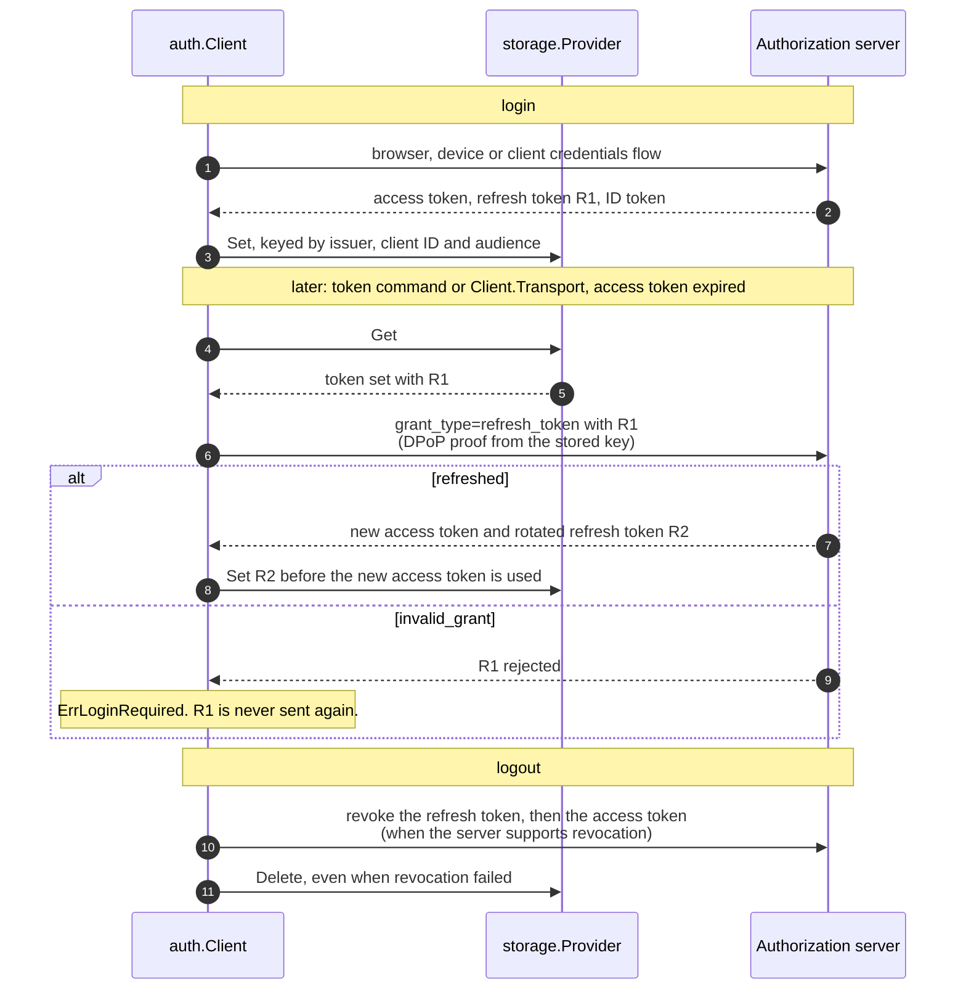

# Security model

A CLI that signs users in holds credentials on their behalf, on a machine
you do not control, often in a shell that logs, pipes and shares its output.
This page summarizes what cobra-oauth2 protects against and how, what it
cannot protect against, and what you, the integrator, should do. To report
a vulnerability, follow [SECURITY.md](../SECURITY.md).

## What is being protected

| Asset | Where it lives | Why it matters |
| --- | --- | --- |
| Refresh token | Storage (keyring by default) | Long-lived: it mints new access tokens for weeks. It is the most valuable item. |
| Access token | Storage, process memory, your API requests | Short-lived but directly usable against your API. |
| ID token | Storage | Identity claims, and possibly personal data (email, name). |
| DPoP private key | Storage, with the tokens | Turns a stolen token into a useless one, as long as it is not stolen too. |
| Client secret or signing key | Your configuration | Only for confidential clients. A secret in a distributed binary is public. |
| Authorization code, PKCE verifier, `state`, `nonce`, device code | Process memory, briefly | Each one could be used to hijack a login in progress. |

## Token lifecycle

A token set is written to storage once at login, rewritten on every refresh,
and deleted at logout. The order of these steps is what keeps a rotating
refresh token from being lost or replayed:

- The token set is stored under a hash of issuer, client ID and audience, so
  tokens for different servers, tenants or APIs never mix.
- Refreshes through one `auth.Client` are serialized, so only one request spends
  the refresh token.
- The rotated refresh token is saved before the new access token is handed
  out. A crash in between leaves the new token, not the spent one, in storage.
- A server that does not rotate refresh tokens returns none, and the stored
  one is kept.
- Logout deletes the local copy even when revocation fails, and reports the
  failure as a warning. A stored record that cannot be read (corrupt, with
  too-open permissions, from a newer version) is deleted too.

## Threats and mitigations

### A malicious or compromised authorization server response

- **Mix-up attacks:** the discovery document must name the configured issuer
  exactly. The RFC 9207 `iss` parameter on the redirect is required when
  advertised and checked whenever present. Endpoints come only from that
  document or your configuration.
- **Downgrade to plain http:** every endpoint, configured or discovered,
  must be https. Loopback http is allowed for local development, and other
  http needs `WithInsecureHTTP`. The default HTTP client requires TLS 1.2 or
  later and never disables certificate verification.
- **Credential replay by redirect:** back-channel POSTs (token, device,
  revocation, PAR, introspection) never follow redirects. A 307/308 would
  otherwise resend the form, with its secrets, to another host. Discovery
  and JWKS GETs follow only same-origin redirects. On API calls,
  `Client.Transport` follows a redirect to another origin without the access
  token or DPoP proof.
- **Loopback names:** plain http is accepted for back-channel endpoints only
  on loopback addresses and the exact name `localhost`. Names under
  `.localhost` are accepted only for URLs handed to the browser, because Go's
  pure-Go resolver (used by `CGO_ENABLED=0` builds) asks DNS for them.
- **Oversized or hostile bodies:** responses are capped at 1 MiB. Error
  descriptions, user codes, URIs, ID token claims and the granted scope are
  stripped of control characters, ANSI and OSC escape sequences and
  bidirectional overrides, and truncated, before they reach a terminal or an
  error message (a scope token carrying one is dropped when the response is
  parsed). The same goes for transport errors, whose TLS messages quote the
  DNS names of whatever certificate a network attacker presented, and a
  server URL whose query carries such characters is refused. Raw bodies never
  appear in errors, and nothing from a hostile
  response can make the library panic.
- **Dangerous URLs:** only https (or loopback http) URLs from the server are
  printed or handed to the OS browser opener. `file:`, `javascript:`, custom
  protocol handlers and URLs with userinfo are refused.
- **Forged ID tokens:** they are verified against the provider's JWKS, with
  asymmetric algorithms only (`none` and HS* are refused). The checks cover
  issuer, audience and `azp`, expiry, and `nonce`. A refreshed ID token must
  name the same subject.

### Another program on the same machine

- **The loopback redirect:** the listener binds `127.0.0.1` (or `[::1]`),
  never all interfaces, and lives only for one login. With
  `WithRedirectHost("localhost")` it binds both on the same port, since the
  browser may resolve the name to either, and fails rather than leave the
  `::1` port to another user's process. It answers only the
  redirect path, accepts a single response with the right `state` (256 bits,
  compared in constant time) and shuts down after it. A local process that
  races to the port cannot complete the login without the PKCE verifier,
  which never leaves the process.
- **Stored tokens:** the default store is the OS keyring, which is
  per user and encrypted at rest by the OS. The file store writes `0600`
  files in a `0700` directory, atomically, and on Unix refuses to read a
  file that other users can access. Another process running **as the same user** can
  generally read either store. That is outside what a library can prevent;
  DPoP reduces the damage only if the key is not taken as well.
- **Shared keyring entries:** entries are keyed by a hash of issuer, client
  ID and audience. Each record also names its key, and a mismatch is
  treated as absent, so a staging token is never sent to production.

### Leaks through output, logs and shells

- The `token` command writes the access token, and nothing else, to stdout.
  Prompts, progress and warnings go to stderr, so
  `TOKEN=$(mycli auth token)` does not capture a prompt, and a prompt never
  ends up in a pipe.
- `status` never prints a token. `token --json` prints the access token with
  its metadata, never the refresh or ID token.
- `storage.Token`, `auth.Client` and `auth.DeviceAuthorization` redact their
  secrets (for the client: its secret and signing keys) in `String`,
  `GoString` (`%#v`) and `slog.LogValue`. `WithLogger` receives events, not
  secrets. The browser login's loopback server logs to it too, never to the
  process's stderr.
- The device code is never displayed; only the user code is.
- The library never writes to the process's stdout or stderr on its own. It
  writes only to the writers you configure (`WithOutput`), which the commands
  set to their own. The browser opener's output is discarded so that it
  cannot corrupt `token` output.

### Token theft and replay

- **PKCE** (S256, always) binds the authorization code to this process.
- **DPoP** (opt-in, `WithDPoP` / `WithDPoPAuto`) binds access and refresh
  tokens to a private key. Each login gets a new key, and each request a
  new proof with a unique `jti`. Authorization and device codes are bound to
  the key with `dpop_jkt`.
- **Refresh rotation:** a rotated refresh token is saved before the new
  access token is used. A failed refresh is never retried with the spent
  token, because servers treat that as theft and revoke the grant.
- **Logout** revokes the refresh token at the server (which on most servers
  ends the whole grant), then the access token, then deletes the local
  copy. The local delete happens even when revocation fails.

### Phishing in the device flow

The device flow is inherently phishable: an attacker can start a device
authorization and persuade a victim to enter the attacker's code. The prompt
shows the verification URL and code clearly, and asks the user to check that
the code shown in the browser matches. Prefer the browser flow wherever a
browser is available. `FlowAuto` does exactly that.

## Known limits

- **Refresh locking is per machine.** Parallel runs on one machine share a
  lock file per token set, so only one of them refreshes. Machines that share
  a token store over the network are not coordinated. A custom storage
  provider is locked only if it implements `storage.Locker` (or the client
  is given one with `WithLocker`).
- **The DPoP key is software-held** and stored next to the tokens. A
  client-authentication key can live in hardware, because `WithPrivateKeyJWT`
  accepts any `crypto.Signer`, but the DPoP key cannot yet.
- **`id_token_hint`** (opt-in with `WithEndSession`) puts the ID token in a
  URL, which ends up in the printed output and the browser history.
- **`WithInsecureHTTP` and `WithIDTokenValidation(false)`** do exactly what
  they say. Use them only against test servers.
- **The keyring backend** is whatever the OS offers. On Linux without a
  Secret Service (minimal containers, many SSH sessions) it is unavailable;
  see the fallback advice below.

## Recommendations for integrators

1. **Ship a public client.** Do not compile a client secret into a binary you
   distribute: anyone can extract it. Use PKCE (automatic) and, where your
   provider supports it, DPoP. The exception is providers that require a
   non-confidential secret for installed apps (Google). Treat that value as
   public.
2. **Keep confidential credentials out of the binary.** For CI and services
   with `FlowClientCredentials`, read the secret from the environment or a
   secret manager at run time, as `examples/client_credentials` does.
   Prefer `WithPrivateKeyJWT` to a shared secret.
3. **Request the least you need.** Set `WithScopes`, `WithAudience` or
   `WithResource` to your API's actual needs. Include `offline_access` only if
   users should stay signed in.
4. **Pin the storage identity.** Set `WithAppName("com.example.mycli")` so a
   renamed binary does not lose, or worse share, stored logins.
5. **Plan for machines without a keyring.**
   `storage.Fallback(storage.NewKeyring(app), storage.NewFile(dir))` keeps
   tokens in the keyring when one exists, and in an owner-only file
   otherwise. Tell your users where the file lives. `storage.NewMemory()`
   suits one-shot CI jobs.
6. **Call your API through `Client.Transport`.** It refreshes tokens, adds
   DPoP proofs and never puts the token in a URL. It sends the token only to
   the origins it is bound to (`WithAllowedOrigins`, else the `WithResource`
   URLs, else the first request's origin), never to the target of a
   cross-origin redirect, and never over plain http to a remote host. Bind it
   explicitly when one client calls several hosts, and set `CheckRedirect` on
   the `http.Client` if your API never redirects. If you copy the token into
   your own headers, never put it in a query string, never follow redirects
   with it, and never log the request headers.
7. **Mind your own output.** Do not print `Token.AccessToken`,
   `RefreshToken` or `IDToken` in debug output. Printing the `Token` value
   itself is safe. Do not attach a raw response body to an error.
8. **Keep TLS strict.** If you need a corporate proxy or a private CA, set
   them on the `*http.Client` you pass to `WithHTTPClient`, rather than
   turning off verification.
9. **Tell users about logout.** `mycli auth logout` revokes at the server
   where it can. On providers without revocation (GitHub, Entra ID, Dex) it
   deletes the local copy only. `WithEndSession` can also end the browser
   session.
10. **Keep dependencies current.** Run `govulncheck ./...` in your CI too:
    this library's dependencies (go-jose, go-keyring, cobra) become yours.
